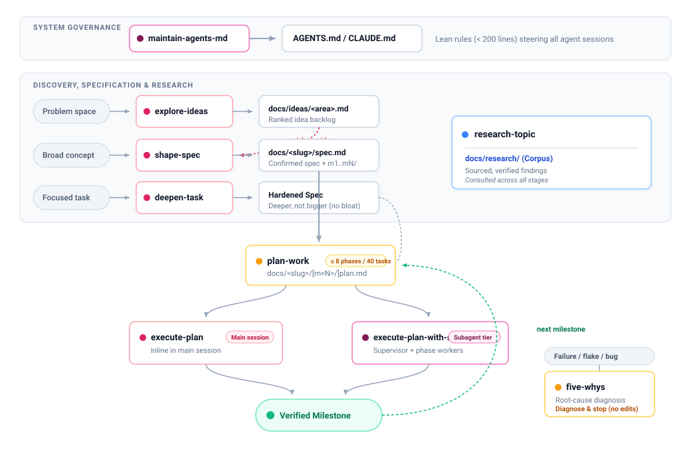

<div align="center">


# PinkRoosterSkills

**Nine portable agent skills: explore ideas, shape a spec, plan the work, execute inline or with phase workers, build a research corpus, keep AGENTS.md lean, diagnose root causes, and deepen tasks.**

[](LICENSE)
[](https://agentskills.io/specification)
[](#development)

[The idea](#the-idea) · [Install](#install) · [Usage](#usage) · [Skills](#skills) · [Compatibility](#compatibility) · [Development](#development)

</div>

---

## The idea

Keep the decisions, constraints, and empirical evidence an agent needs across sessions in ordinary
Markdown files. Each stage has a single, well-defined responsibility and produces a durable handoff
that survives context resets. You can install and use any skill independently: there is no runtime
daemon, database, or build step.

<p align="center">
  <picture>
    <source media="(prefers-color-scheme: dark)" srcset="assets/workflow-dark.svg">
    <source media="(prefers-color-scheme: light)" srcset="assets/workflow-light.svg">
    
  </picture>
</p>

These are instructions an agent follows, not an execution engine or a permission boundary.
Your harness supplies file access, search, questions and shell commands; the delegated
executor also requires working subagent tools. User instructions and project rules take precedence.

### When to Reach for Which Skill

| If your immediate situation is... | Use this skill | What it produces |
|---|---|---|
| A broad problem space or market opportunity with no clear solution yet | [explore-ideas](skills/explore-ideas/SKILL.md) | Ranked, sourced backlog in `docs/ideas/<area>.md` |
| A concrete product feature or system to specify from scratch | [shape-spec](skills/shape-spec/SKILL.md) | Confirmed specification and milestones in `docs/<slug>/spec.md` |
| A brief, ambiguous task, issue ticket, or prompt that risks shallow coding | [deepen-task](skills/deepen-task/SKILL.md) | Expert-grade specification without expanding scope |
| A confirmed specification or milestone ready to break into buildable steps | [plan-work](skills/plan-work/SKILL.md) | Bounded, checkable plan in `docs/<slug>/plan.md` |
| An existing plan to implement sequentially in your current session | [execute-plan](skills/execute-plan/SKILL.md) | Working code, verified checks, and updated plan state |
| An existing plan to implement using isolated subagents while supervising | [execute-plan-with-subagents](skills/execute-plan-with-subagents/SKILL.md) | Supervised phase implementation, verified acceptance, commits |
| An open technical or architectural question needing persistent investigation | [research-topic](skills/research-topic/SKILL.md) | Sourced knowledge corpus in `docs/research/` |
| A test failure, build breakage, or mysterious regression in CI or local code | [five-whys](skills/five-whys/SKILL.md) | Evidence-backed root cause diagnosis and proposed fix |
| Setting up or cleaning agent instruction files under a strict 200-line budget | [maintain-agents-md](skills/maintain-agents-md/SKILL.md) | High-signal, unbloated `AGENTS.md` and `CLAUDE.md` shim |

## Install

Choose your coding harness. Run shell commands in a terminal; start a fresh agent session
once installation finishes.

| Harness | Recommended installation |
|---|---|
| Claude Code | `claude plugin marketplace add pinkroosterai/PinkRoosterSkills`, then `claude plugin install pinkrooster-skills@pinkrooster-skills` |
| Codex CLI | `codex plugin marketplace add pinkroosterai/PinkRoosterSkills`, then `codex plugin add pinkrooster-skills@pinkrooster-skills` |
| Antigravity CLI | `agy plugin install https://github.com/pinkroosterai/PinkRoosterSkills` |
| Pi | `pi install git:github.com/pinkroosterai/PinkRoosterSkills` |
| Cursor, Gemini CLI, GitHub Copilot, OpenCode | `npx skills add pinkroosterai/PinkRoosterSkills` — select your harness and skills |

Native plugins install the complete bundle. The portable skills CLI also supports individual
skills and multiple harnesses; it needs Node.js 22.20 or later. The skills have no runtime
or build step. Install using one method per harness to avoid duplicate skills.

**Verify before starting:** ask your agent, “List the installed PinkRooster skills and read
the plan-work skill. Do not create files or run its workflow.” Expect all nine skills and a
summary of plan-work. This checks discovery and loading, not a complete workflow.

Follow the [installation guide](docs/installation.md) for scope, local checkouts, prerequisites,
updates, removal, troubleshooting and a first-use example. App and IDE surfaces have separate
verification limits; see the [compatibility record](docs/compatibility.md).

## Usage

| Harness | Explicit invocation example |
|---|---|
| Claude Code, standalone | `/plan-work add rate limiting to the API` |
| Claude Code, plugin | `/pinkrooster-skills:plan-work add rate limiting to the API` |
| Codex CLI / IDE | `$plan-work add rate limiting to the API` |
| Pi | `/skill:plan-work add rate limiting to the API` |
| Antigravity | Use its skill selector or ask “Use the plan-work skill to plan API rate limiting” |
| Other skill-capable hosts | Ask for the skill by name; command syntax depends on the host |

Natural requests such as “plan the rate limiting work” can also select a skill through its
description. Selection is model-dependent; explicit invocation is useful when routing is
ambiguous. A handoff names the next step without automatically running it.

## Skills

| Skill | Use it for | Artifacts |
|---|---|---|
| [explore-ideas](skills/explore-ideas/SKILL.md) | Turn a broad problem space into a ranked, sourced idea backlog | `docs/ideas/<area>.md`, `docs/ideas/README.md` |
| [shape-spec](skills/shape-spec/SKILL.md) | Turn one concept into a specification, split into milestones when big, through bounded question rounds and decision readback | `docs/<slug>/spec.md`, `m<N>/milestone.md`, `research.md` |
| [deepen-task](skills/deepen-task/SKILL.md) | Sharpen and deepen a task into a professional-grade specification without expanding scope | Deepened task specification in conversation (or task file) |
| [plan-work](skills/plan-work/SKILL.md) | Turn defined work into phases, assumptions, tasks and acceptance checks, one milestone at a time, within a size limit | `docs/<slug>/plan.md` or `m<N>/plan.md`, `research.md` |
| [execute-plan](skills/execute-plan/SKILL.md) | Implement and verify an existing plan entirely in the main session | Code, plan status, findings in `research.md` |
| [execute-plan-with-subagents](skills/execute-plan-with-subagents/SKILL.md) | Delegate phase implementation while the main session prepares, reviews and verifies | Code, plan status, findings, acceptance evidence |
| [research-topic](skills/research-topic/SKILL.md) | Agree a research scope and preserve sourced findings by topic | `docs/research/README.md` and linked topic files |
| [five-whys](skills/five-whys/SKILL.md) | Investigate software failures with evidence-backed causal analysis and propose an unapplied fix | Diagnostic report in conversation |
| [maintain-agents-md](skills/maintain-agents-md/SKILL.md) | Create or update AGENTS.md (plus a CLAUDE.md shim) by exploring and interviewing, kept within 200 lines and pruned of stale lines | `AGENTS.md`, `CLAUDE.md` |

---

### Explore ideas

Turn a broad ambition into a ranked, sourced idea backlog in `docs/ideas/<area>.md`.

- **Why use it:** Prevents premature implementation and "solution bias" when starting from an open-ended goal. Instead of jumping to code based on an unverified assumption, it grounds the problem in user needs, surveys the landscape for existing solutions or off-the-shelf alternatives, and explores options (including deciding not to build).
- **Workflow:**
  1. *Frame:* Clarifies outcome, target users, and non-negotiable constraints interactively.
  2. *Landscape scan:* Searches for prior art, competitors, and open-source solutions with citations.
  3. *Generate:* Produces at least two candidate ideas per user need. Each idea is rated High/Medium/Low on Value, Confidence, and Effort and names its single riskiest assumption.
  4. *Rank & Persist:* Collaborates with you to prioritize the list. `docs/ideas/<area>.md` and its index are written only after you confirm the ordering.
- **Artifacts & Handoffs:** Produces `docs/ideas/<area>.md` and updates `docs/ideas/README.md`. Advance any chosen idea to specification with `/shape-spec idea <id> from docs/ideas/<area>.md`.
- **Invocation:** `/explore-ideas track token costs per customer for AI-heavy SaaS teams`

### Shape a concept

Turn a concept or backlog idea into a buildable specification in `docs/<slug>/spec.md`.

- **Why use it:** Eliminates meandering, open-ended requirement interviews. Instead of asking dozens of questions up front, it inspects your codebase and drafts a specification first, categorizes unknowns (blocking gaps vs thin sections vs deferred questions), and records confirmed decisions so requirements don't slip. For large features, it automatically cuts a minimal, end-to-end first slice (M1) so projects ship incrementally.
- **Workflow:**
  1. *Draft & Orient:* Inspects local code and drafts an initial specification covering goals, architecture, and interfaces.
  2. *Bounded Interview:* Conducts focused question rounds targeting only blocking gaps. Offers deep surveys or library comparisons to `research-topic` mid-run.
  3. *Milestone Slicing:* Automatically divides large scopes into discrete milestones (`m1/`, `m2/`...), where M1 is the thinnest slice working end-to-end. Each milestone gets a folder `docs/<slug>/m<N>/` with a small `milestone.md` pointing into the spec, and the spec keeps a one-line index with each milestone's status. Name `<slug>/m<N>` to re-cut a milestone.
  4. *Decision Readback:* Confirms active decisions with you and marks the specification buildable.
- **Artifacts & Handoffs:** Produces `docs/<slug>/spec.md`, `m<N>/milestone.md`, and `research.md`. Advance to planning with `/plan-work implement docs/<slug>/spec.md` or `/plan-work <slug>/m1`.
- **Invocation:** `/shape-spec a CLI that syncs an Obsidian vault to S3`

### Deepen a task

Transform an ambiguous, shallow task, issue ticket, or prompt into a professional specification without expanding scope.

- **Why use it:** Prevents shallow code, hallucinated features, and unverified edge cases. When given a brief task ("add rate limiting", "refactor auth"), agents often invent arbitrary SLAs, omit security traps, or miss concurrency hazards. Operating under the core principle *"I want a deeper version of this task, not a bigger one"*, it sharpens rigor, identifies expert omissions, and establishes falsifiable verification while keeping boundaries firm.
- **Workflow:**
  1. *Triage:* Evaluates the prompt or task file for idempotency and catches critical ambiguities before proceeding.
  2. *5-Point Analysis:* Analyzes workspace/external standards, uncovers consequential omissions and traps, identifies primary evidence to inspect, selects stack-aligned methods, and defines independent verification without fabricated metrics.
  3. *Separate Research Phases:* Clearly separates research informing the specification from empirical baselines the implementer must measure during execution.
  4. *Deliver Output Contract:* Delivers concise key findings followed by a self-contained, copyable Markdown specification.
- **Artifacts & Handoffs:** Delivers a complete specification in conversation. If a task file was provided, offers to write `<filename>.deepened.md`. Implement directly with your coding agent or feed into `/plan-work` if complex.
- **Invocation:** `/deepen-task add rate limiting to public endpoints` or `/deepen-task path/to/task.md`

### Plan defined work

Turn a confirmed specification or milestone into a phased execution plan in `docs/<slug>/plan.md`.

- **Why use it:** Bridges high-level specifications and actual code execution. It prevents sprawling, runaway plans that overwhelm an agent's context window by enforcing hard limits (maximum 8 phases and 40 tasks per plan) and planning one milestone at a time. It ensures every phase has observable completion checks and surfaces prerequisite risks before any code is modified.
- **Workflow:**
  1. *Scope Check:* Evaluates the spec or milestone. A spec with milestones is planned one milestone at a time (`docs/<slug>/m1/plan.md`, then `m2/plan.md` once M1 is done): name one as `<slug>/m2`, or leave it off and the lowest unfinished milestone is taken automatically. Over the limit with no milestones, it stops and offers to split the spec, plan a first slice, or let you override with a dated rationale.
  2. *Structure Phases:* Breaks implementation into logical phases (setup, core implementation, validation).
  3. *Risk & Assumptions:* Explicitly identifies "Settle first" questions and architectural assumptions.
  4. *Checkable Tasks:* Writes discrete tasks stating *what* and *where* (leaving *how* to execution), each backed by an observable "Done when" condition.
- **Artifacts & Handoffs:** Produces `docs/<slug>/plan.md` or `docs/<slug>/m<N>/plan.md` (legacy `plan-m<N>.md` still supported). Never writes application code. Handoff to `/execute-plan` (inline) or `/execute-plan-with-subagents` (delegated).
- **Invocation:** `/plan-work docs/obsidian-sync/spec.md` or `/plan-work obsidian-sync/m1`

### Execute a plan

Implement an existing plan sequentially entirely within the main session.

- **Why use it:** Drives a plan to completion within your current agent session. Perfect for environments without subagent support, for tightly coupled codebases where maintaining continuous context is advantageous, or when you want to watch every edit and test run inline.
- **Workflow:**
  1. *Initialize:* Locates unfinished plans. Given a bare slug with several plans, it takes the unfinished one (or asks if several qualify); with no argument, it lists unfinished plans to resume. **Started without being named?** When selected from a vague request like "carry on" rather than by explicit name, it states the plan and phase and waits for confirmation before its first edit or commit.
  2. *Execute Phase:* Slices through phase tasks, settles open questions, runs focused unit checks, and records findings in `research.md`.
  3. *Verify "Done when":* Independently verifies the phase's observable acceptance criteria before closing it.
  4. *Update State:* Updates plan checkboxes and phase statuses directly on disk for durable resumption; creates one commit per phase when permitted.
- **Artifacts & Handoffs:** Implements code changes, updates plan status, records findings. Runs single phases with `--phase N`. If a milestone plan has remaining milestones, advances to `/plan-work` for the next milestone (`m2`).
- **Invocation:** `/execute-plan obsidian-sync` or `/execute-plan obsidian-sync/m1 --phase 2`

### Execute with phase workers

Implement an existing plan using isolated subagents for each phase while retaining supervisor control.

- **Why use it:** Scales plan execution across complex projects by using isolated subagents for implementation while retaining supervisor control in the main session. Keeps the main session context clean from compilation noise and test output. Crucially, verification is never delegated: the worker implements and repairs, but the supervisor independently validates "Done when" before accepting the phase.
- **Workflow:**
  1. *Supervise & Prepare:* Main session checks prerequisites, settles open questions, and defines strict file boundaries. **Selected without being named?** When chosen implicitly from a request like "carry on", it states the plan, phase, and delegated mode and waits for confirmation before any edit, dispatch, or commit.
  2. *Dispatch Worker:* Spawns a fresh subagent with the settled phase scope and worker role.
  3. *Worker Implementation:* Subagent executes tasks and focused checks, reporting progress checkpoints back to the supervisor.
  4. *Independent Acceptance:* Main session reviews git diffs, runs phase verification commands itself, dispatches targeted repair instructions if checks fail, and commits upon acceptance.
- **Artifacts & Handoffs:** Implements code changes, maintains execution logs, updates plan status. Subagent support is required: without it, the skill stops and names `execute-plan` as the inline alternative (it never switches execution modes automatically). Stock Pi needs a subagent extension.
- **Invocation:** `/execute-plan-with-subagents obsidian-sync` or `/execute-plan-with-subagents obsidian-sync/m1`

### Research a topic

Build and preserve a sourced, cross-referenced research corpus under `docs/research/`.

- **Why use it:** Prevents transient, disposable chat answers by building a permanent, cross-referenced research corpus under `docs/research/`. Avoids duplicate searches across sessions and ensures architectural decisions are grounded in verified, authoritative sources.
- **Workflow:**
  1. *Scout:* Performs a shallow initial pass (5–8 searches) to map the topic's shape and determine if it splits into independent angles.
  2. *Scope Gate:* Agrees the research angles and budget with you (hard gate—nothing lands on disk without approval).
  3. *Dispatch:* Researches inline or delegates up to 10 independent angles to parallel subagents operating in an isolated scratch directory outside git.
  4. *Synthesize & Verify:* Synthesizes findings into `docs/research/<topic>.md`, verifies that every citation URL was opened and supports its claim, cleans up scratch reports, and updates the corpus index.
- **Artifacts & Handoffs:** Produces `docs/research/<topic>.md` and updates `docs/research/README.md`. Referenced automatically by `shape-spec`, `plan-work`, and execution.
- **Invocation:** `/research-topic compare device authorization flows and OAuth 2.1 recommendations`

### Diagnose an issue

Investigate software failures using structured causal analysis and propose an unapplied fix.

- **Why use it:** Stops the common failure mode where coding agents frantically guess patches, thrash code, or apply superficial band-aids to failing tests. `five-whys` conducts an evidence-backed root cause investigation using causal chains. It is strictly non-destructive: it analyzes evidence and proposes an unapplied fix, but never edits code, creates repro scripts, installs dependencies, or mutates configuration during diagnosis.
- **Workflow:**
  1. *Frame:* Captures expected vs actual behavior, reproduction conditions, and isolates symptoms.
  2. *Inspect Evidence:* Examines source code, git history, logs, traces, or isolated test outputs. Existing tests run only when side effects are known and isolated.
  3. *Causal Investigation:* Builds a causal chain ("Why did X occur? Because Y"), testing competing hypotheses against evidence.
  4. *Evaluate Causes:* Distinguishes the runtime failure mechanism from missing prevention controls; checks if breaking a link resolves the failure path.
  5. *Conclude & Propose:* Classifies diagnosis as *Supported*, *Provisional*, or *Unresolved*; proposes a targeted correction and validation plan without applying edits.
- **Artifacts & Handoffs:** Delivers a structured diagnostic report in conversation (no file written by default). Stops after the report; confirmation of a diagnosis is not permission to implement. Hand off to direct implementation or `/deepen-task` to specify the repair.
- **Invocation:** `/five-whys test_token_refresh fails intermittently in CI`

### Maintain AGENTS.md

Keep project agent instructions sharp, accurate, and within a strict 200-line budget.

- **Why use it:** Prevents "instruction rot" and context window waste. Project steering files often bloat to hundreds of lines with discoverable boilerplate (re-explaining READMEs, directory listings, or standard framework idioms) or go stale when commands change. `maintain-agents-md` enforces a hard 200-line budget, creates a one-line `@AGENTS.md` shim for `CLAUDE.md`, and records only durable, non-discoverable project conventions.
- **Workflow:**
  1. *Triage Mode:* Detects whether to `create` (no instruction file exists), `update` (a new durable fact surfaced), or `audit` (pruning existing files).
  2. *Explore & Interview:* Inspects project files for non-obvious conventions (build flags, test setups, architectural rules) and interviews you for team policies.
  3. *Strict Line Count:* Measures text using exact line counts (`wc -l`), verifying that content stays within the 200-line budget.
  4. *Review & Write:* When triggered autonomously, shows a diff and waits for user approval before modifying files. Writes `AGENTS.md` and the single-line shim `@AGENTS.md` to `CLAUDE.md`.
  5. *Autonomous Monitoring:* Automatically suggests an update mid-session when you correct a convention or a command changes.
- **Artifacts & Handoffs:** Produces or updates `AGENTS.md` and `CLAUDE.md`. Governs all future agent interactions across the repository.
- **Invocation:** `/maintain-agents-md create`, `/maintain-agents-md audit`, or `/maintain-agents-md update the test command is now pnpm test`

---

## Persistence and delegation

Skills normally create local commits, subject to your instructions and project checks.
They preserve unrelated working-tree and staged changes. In a non-Git project, when commits
are prohibited, or when changes cannot safely be isolated, artifacts remain uncommitted
with an explanation. No skill pushes changes or changes repository visibility.

Subagents receive a bounded job and a role pasted from `references/roles/`; no custom agent
definitions are installed. The main agent owns decisions, shared documents, phase acceptance
and commits. execute-plan runs all work inline; execute-plan-with-subagents delegates
implementation and repairs while retaining preparation, review and acceptance in the main
session. Destructive or irreversible commands are never delegated: the main agent shows
the exact command and runs it only after you confirm. Models, reasoning effort and concurrency adapt to the tools actually available.
A worker's report is checked against its changes before being trusted.

## Compatibility

The common [Agent Skills format](https://agentskills.io/specification) makes the instruction
bundles portable; it does not standardize tool APIs, permissions or command syntax.
See [the compatibility record](docs/compatibility.md) for dated evidence and limitations.
Historical checks cover installation, a no-plan path and scout dispatch in Claude Code,
Codex and Antigravity. Pi and complete cross-harness workflows remain unverified. Sandboxed
sessions (for example Codex's default `workspace-write`) may block network access, writes
outside the project, or commits; each skill's `compatibility` field states what it needs.

`argument-hint` is a deliberate Claude Code frontmatter extension. Strict `skills-ref`
validation reports it as unsupported; this is documented rather than counted as a pass.
The local checker validates this repository's restricted frontmatter conventions, not all YAML.

Official references: [Claude Code](https://code.claude.com/docs/en/skills),
[Codex](https://learn.chatgpt.com/docs/build-skills),
[Antigravity](https://antigravity.google/docs/skills),
[Pi](https://github.com/earendil-works/pi/blob/main/packages/coding-agent/docs/skills.md),
and [OpenCode](https://opencode.ai/docs/skills/).

## Development

Contributor checks require Bash, standard Unix utilities and `jq`. Native package validation
also requires the corresponding harness CLI; the skills themselves have no runtime dependencies.

```bash
bash scripts/check-skills.sh
bash scripts/test-check-skills.sh # includes standalone validator fixtures
bash scripts/test-execution-fixtures.sh # execution fixture setup and check contracts
bash scripts/test-five-whys-fixtures.sh # diagnostic fixture contracts, no model calls
bash scripts/check-packages.sh # requires jq
claude plugin validate .
# Optional strict format validation (argument-hint is a known extension):
npx -y skills-ref validate skills/plan-work
# Paid behavioral evaluation; choose an explicit budget:
claude plugin eval . --trust-plugin --max-cost-usd 5
```

Artifacts land in `docs/` unless your project's instructions or layout name another
documentation root; `research` is reserved for the corpus and never used as a slug.

Skills live in `skills/<name>/SKILL.md`, supporting material in `references/`, and behavioral
cases in `evals/`. See [AGENTS.md](AGENTS.md) for maintenance rules and
[evals/README.md](evals/README.md) for test coverage. Edit shared references in `plan-work`
first, then copy them into the standalone consumers; the checker rejects drift.

Keep discovery descriptions short and explicit about use cases and exclusions. Update the
[changelog](CHANGELOG.md) and all package version records when preparing a release.
The project is [MIT licensed](LICENSE). The header logo is shared with
[PinkRooster](https://github.com/pinkroosterai/PinkRooster).

Bundled mechanical validators and their Markdown limits are documented in
[the validation guide](skills/plan-work/references/validation.md). They ship with each
consuming skill and run without the contributor checkout. Hooks remain deferred.
