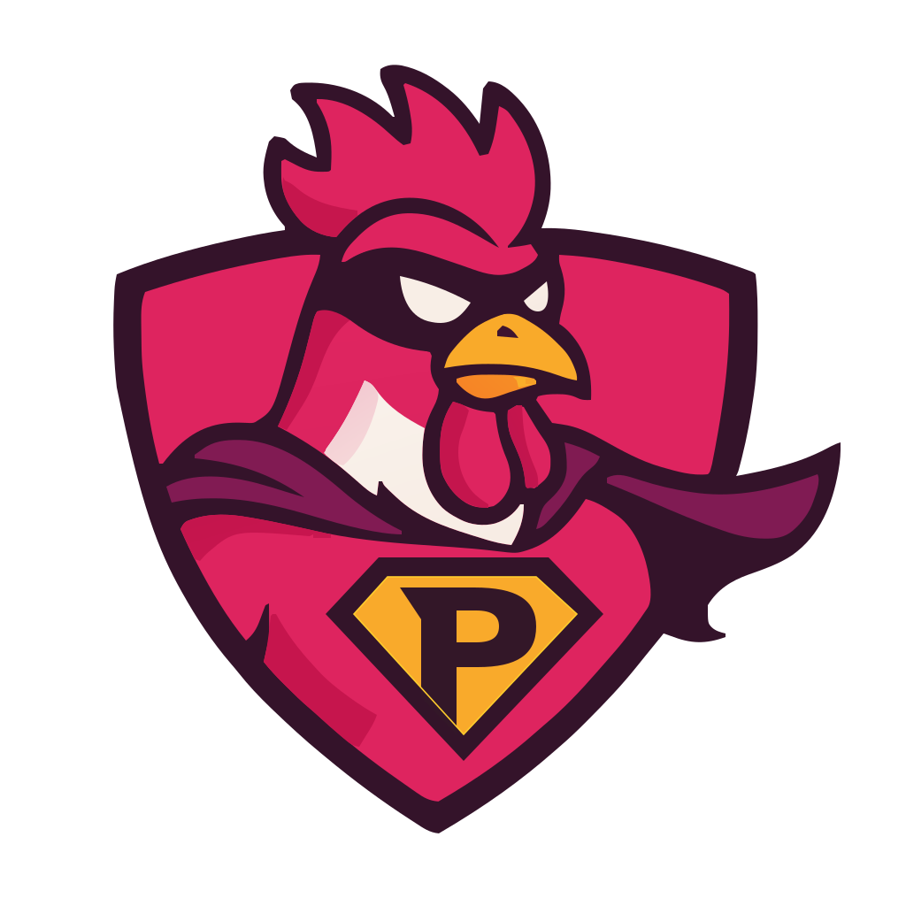

<div align="center">



# PinkRoosterSkills

**Seven portable agent skills: explore ideas, shape a spec, plan the work, execute inline or with phase workers, build a research corpus, and keep AGENTS.md lean.**

[](LICENSE)
[](https://agentskills.io/specification)
[](#development)

[The idea](#the-idea) · [Install](#install) · [Usage](#usage) · [Skills](#skills) · [Compatibility](#compatibility) · [Development](#development)

</div>

---

## The idea

Keep the decisions and evidence that an agent needs for the next session in ordinary
Markdown files. Each stage has a distinct job and a durable handoff; you can install and
use any skill on its own. There is no application runtime or build step.

```text
problem space → explore-ideas → docs/ideas/<area>.md (ranked backlog)
                                        │ one idea
                                        ▼
concept ──────────────────────→ shape-spec → spec.md (+ m1/ … mN/)
                                                 │
            ┌────────────────────────────────────┘
            ▼
       plan-work → m<N>/plan.md → execution mode → verified milestone ─┐
            ▲                                                         │
            └───────────────────── next milestone ───────────────────┘

research-topic → docs/research/ corpus, read first by every stage
```

These are instructions an agent follows, not an execution engine or a permission boundary.
Choose execute-plan for inline execution or execute-plan-with-subagents for phase workers.
Your harness supplies file access, search, questions and shell commands; the delegated
executor also requires working subagent tools.
User instructions and project rules take precedence.

## Install

Choose your coding harness. Run shell commands in a terminal; start a fresh agent session
once installation finishes.

| Harness | Recommended installation |
|---|---|
| Claude Code | `claude plugin marketplace add pinkroosterai/PinkRoosterSkills`, then `claude plugin install pinkrooster-skills@pinkrooster-skills` |
| Codex CLI | `codex plugin marketplace add pinkroosterai/PinkRoosterSkills`, then `codex plugin add pinkrooster-skills@pinkrooster-skills` |
| Antigravity CLI | `agy plugin install https://github.com/pinkroosterai/PinkRoosterSkills` |
| Pi | `pi install git:github.com/pinkroosterai/PinkRoosterSkills` |
| Cursor, Gemini CLI, GitHub Copilot, OpenCode | `npx skills add pinkroosterai/PinkRoosterSkills` — select your harness and skills |

Native plugins install the complete bundle. The portable skills CLI also supports individual
skills and multiple harnesses; it needs Node.js 22.20 or later. The skills have no runtime
or build step. Install using one method per harness to avoid duplicate skills.

**Verify before starting:** ask your agent, “List the installed PinkRooster skills and read
the plan-work skill. Do not create files or run its workflow.” Expect all seven skills and a
summary of plan-work. This checks discovery and loading, not a complete workflow.

Follow the [installation guide](docs/installation.md) for scope, local checkouts, prerequisites,
updates, removal, troubleshooting and a first-use example. App and IDE surfaces have separate
verification limits; see the [compatibility record](docs/compatibility.md).

## Usage

| Harness | Explicit invocation example |
|---|---|
| Claude Code, standalone | `/plan-work add rate limiting to the API` |
| Claude Code, plugin | `/pinkrooster-skills:plan-work add rate limiting to the API` |
| Codex CLI / IDE | `$plan-work add rate limiting to the API` |
| Pi | `/skill:plan-work add rate limiting to the API` |
| Antigravity | Use its skill selector or ask “Use the plan-work skill to plan API rate limiting” |
| Other skill-capable hosts | Ask for the skill by name; command syntax depends on the host |

Natural requests such as “plan the rate limiting work” can also select a skill through its
description. Selection is model-dependent; explicit invocation is useful when routing is
ambiguous. A handoff names the next step without automatically running it.

## Skills

| Skill | Use it for | Artifacts |
|---|---|---|
| [explore-ideas](skills/explore-ideas/SKILL.md) | Turn a broad problem space into a ranked, sourced idea backlog | `docs/ideas/<area>.md`, `docs/ideas/README.md` |
| [shape-spec](skills/shape-spec/SKILL.md) | Turn one concept into a specification, split into milestones when big, through bounded question rounds and decision readback | `docs/<slug>/spec.md`, `research.md` |
| [plan-work](skills/plan-work/SKILL.md) | Turn defined work into phases, assumptions, tasks and acceptance checks, one milestone at a time, within a size limit | `docs/<slug>/plan.md` or `plan-m<N>.md`, `research.md` |
| [execute-plan](skills/execute-plan/SKILL.md) | Implement and verify an existing plan entirely in the main session | Code, plan status, findings and spec corrections |
| [execute-plan-with-subagents](skills/execute-plan-with-subagents/SKILL.md) | Implement each phase in a worker and check acceptance in a separate verifier | Code, plan status, findings, acceptance evidence and spec corrections |
| [research-topic](skills/research-topic/SKILL.md) | Agree a research scope and preserve sourced findings by topic | `docs/research/README.md` and linked topic files |
| [maintain-agents-md](skills/maintain-agents-md/SKILL.md) | Create or update AGENTS.md (plus a CLAUDE.md shim) by exploring and interviewing, kept within 200 lines and pruned of stale lines | `AGENTS.md`, `CLAUDE.md` |

### Explore ideas

Ask: “I want to build a SaaS for teams that track token costs per customer — help me work out
what to build.” The skill frames the outcome, users and constraints with you, scans what
already exists with sources, and generates at least two ideas per user need, including not
building at all. Each idea is rated High/Medium/Low on value, confidence and effort and names
its riskiest assumption. You set the order; only then is `docs/ideas/<area>.md` written. A
later run revises the same backlog. Take an idea forward with
`/shape-spec idea I3 from docs/ideas/<area>.md`.

### Shape a concept

Ask: “Use shape-spec for a CLI that synchronizes an Obsidian vault to S3.” The skill drafts
before interviewing, distinguishes blocking gaps from thin sections and deferred questions,
and confirms active decisions before calling the spec buildable. Superseded decisions stay
as history and do not re-enter the confirmation queue. A question that needs a real survey —
a contested field, alternatives to compare — is offered to research-topic mid-run; if you
accept, shape-spec pauses, the research lands in the corpus, and shaping resumes from it.
A big concept is split into milestones — M1 is the thinnest slice that works end to end —
which you confirm like any other decision. Each milestone gets its own folder `m1/`, `m2/` …
beside the spec with a small `milestone.md` that points into the spec, and the spec keeps a
one-line index with each milestone's status. Name a milestone as `<slug>/m<N>` to re-cut it. A request that is really a problem space is
offered to explore-ideas first. Resume by naming the existing slug.

### Plan defined work

Ask: “Use plan-work to implement docs/obsidian-sync/spec.md.” The plan lands beside the spec.
Each phase records assumptions, unsettled questions, tasks and an observable completion
condition. A trivial edit does not need a plan. Planning stops at the handoff.
A plan holds at most eight phases and forty tasks, each phase coherent with its own checkable done condition.
A spec with milestones is planned one milestone at a time (`m1/plan.md`, then `m2/plan.md`
once M1 is done): name one as `<slug>/m2`, or leave it off and the lowest milestone not yet
done is taken. Plans written under the older `plan-m1.md` layout still run. Over the limit with no milestones, plan-work stops and offers to split the
spec, plan a first slice, or let you override.

### Execute a plan

Ask: “Use execute-plan for obsidian-sync.” All research, implementation, checks and repairs
run in the main session. Execution checks assumptions, settles open
questions and verifies completion before advancing. Missing acceptance criteria are resolved
before implementation. `--phase N` selects a phase; its prerequisites still must hold.
Progress remains on disk for resumption after interruption. Started from a vague request
rather than by name, it confirms the plan and phase before its first edit.

### Execute with phase workers

Ask: “Use execute-plan-with-subagents for obsidian-sync.” It consumes the same plan files,
milestone sub-slugs and `--phase N` selection as execute-plan. Each phase starts a fresh
implementation worker; phases run sequentially.

The worker checks prerequisites and researches `Settle first`. The main session records the
findings and settles decisions before implementation begins. The worker then implements
the whole phase and any repairs, reporting task checkpoints as it goes. A separate verifier
checks the requirements and runs `Done when`; the main session reviews the evidence before
marking the phase done. The main session retains user questions, shared documents and commits.

This uses one phase worker and one verifier per phase, with additional context and checking
overhead. Model and reasoning settings inherit the harness defaults unless you choose
otherwise. Subagent support is required: without it, the skill stops and names execute-plan
as the inline alternative. It does not switch modes automatically. Stock Pi needs a
subagent extension for this skill.

### Research a topic

Ask: “Use research-topic to compare device authorization flows and preserve the findings.”
The skill scouts first, confirms scope and budget, then researches inline or delegates
independent angles within available slots. Reports live in a unique scratch directory outside
the working tree (`~/.cache`, else the temporary directory; if neither is writable it asks). Changed claims are checked against source evidence before scratch cleanup.
For a chat-only answer or read-only review, ask directly rather than invoking this workflow.

## Persistence and delegation

Skills normally create local commits, subject to your instructions and project checks.
They preserve unrelated working-tree and staged changes. In a non-Git project, when commits
are prohibited, or when changes cannot safely be isolated, artifacts remain uncommitted
with an explanation. No skill pushes changes or changes repository visibility.

Subagents receive a bounded job and a role pasted from `references/roles/`; no custom agent
definitions are installed. The main agent owns decisions, shared documents, phase acceptance
and commits. execute-plan runs all checks inline; execute-plan-with-subagents assigns acceptance
checks to its separate verifier. Destructive or irreversible commands are never delegated: the main agent shows
the exact command and runs it only after you confirm. Models, reasoning effort and concurrency adapt to the tools actually available.
A worker's report is checked against its changes before being trusted.

## Compatibility

The common [Agent Skills format](https://agentskills.io/specification) makes the instruction
bundles portable; it does not standardize tool APIs, permissions or command syntax.
See [the compatibility record](docs/compatibility.md) for dated evidence and limitations.
Historical checks cover installation, a no-plan path and scout dispatch in Claude Code,
Codex and Antigravity. Pi and complete cross-harness workflows remain unverified. Sandboxed
sessions (for example Codex's default `workspace-write`) may block network access, writes
outside the project, or commits; each skill's `compatibility` field states what it needs.

`argument-hint` is a deliberate Claude Code frontmatter extension. Strict `skills-ref`
validation reports it as unsupported; this is documented rather than counted as a pass.
The local checker validates this repository's restricted frontmatter conventions, not all YAML.

Official references: [Claude Code](https://code.claude.com/docs/en/skills),
[Codex](https://learn.chatgpt.com/docs/build-skills),
[Antigravity](https://antigravity.google/docs/skills),
[Pi](https://github.com/earendil-works/pi/blob/main/packages/coding-agent/docs/skills.md),
and [OpenCode](https://opencode.ai/docs/skills/).

## Development

Contributor checks require Bash, standard Unix utilities and `jq`. Native package validation
also requires the corresponding harness CLI; the skills themselves have no runtime dependencies.

```bash
bash scripts/check-skills.sh
bash scripts/test-check-skills.sh # includes standalone validator fixtures
bash scripts/test-execution-fixtures.sh # execution fixture setup and check contracts
bash scripts/check-packages.sh # requires jq
claude plugin validate .
# Optional strict format validation (argument-hint is a known extension):
npx -y skills-ref validate skills/plan-work
# Paid behavioral evaluation; choose an explicit budget:
claude plugin eval . --trust-plugin --max-cost-usd 5
```

Artifacts land in `docs/` unless your project's instructions or layout name another
documentation root; `research` is reserved for the corpus and never used as a slug.

Skills live in `skills/<name>/SKILL.md`, supporting material in `references/`, and behavioral
cases in `evals/`. See [AGENTS.md](AGENTS.md) for maintenance rules and
[evals/README.md](evals/README.md) for test coverage. Edit shared references in `plan-work`
first, then copy them into the standalone consumers; the checker rejects drift.

Keep discovery descriptions short and explicit about use cases and exclusions. Update the
[changelog](CHANGELOG.md) and all package version records when preparing a release.
The project is [MIT licensed](LICENSE). The header logo is shared with
[PinkRooster](https://github.com/pinkroosterai/PinkRooster).

Bundled mechanical validators and their Markdown limits are documented in
[the validation guide](skills/plan-work/references/validation.md). They ship with each
consuming skill and run without the contributor checkout. Hooks remain deferred.
